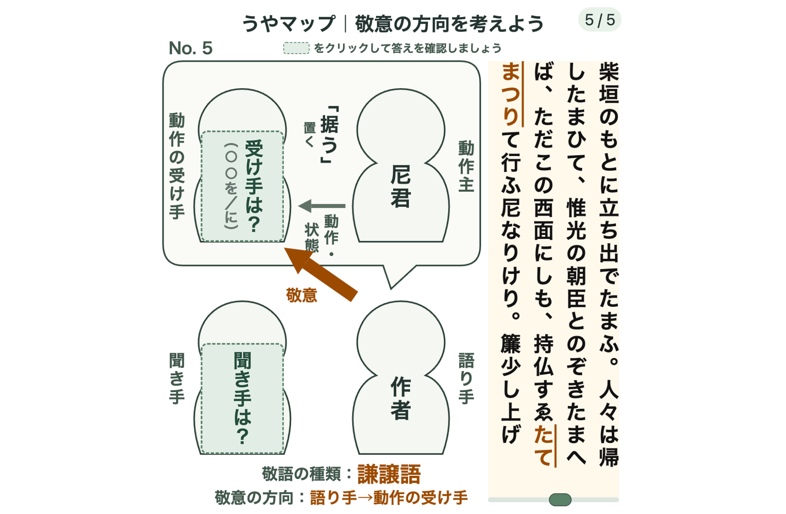

うやマップ（UyaMap）は、敬意の方向を図にする敬語の学習ツールです。Excelファイルやテキストファイルを読み込み、授業やプリントに使える図を作成できます。

作成した図はPNG画像として保存できます。
またファイルを内蔵したＵＲＬを生成し、生徒に配布することもできます。
授業中や復習に使える練習モードも付いています。敬意の方向の図の要素を隠して、順に考えることができます。

[うやマップを開く](https://uyamap.netlify.app)
